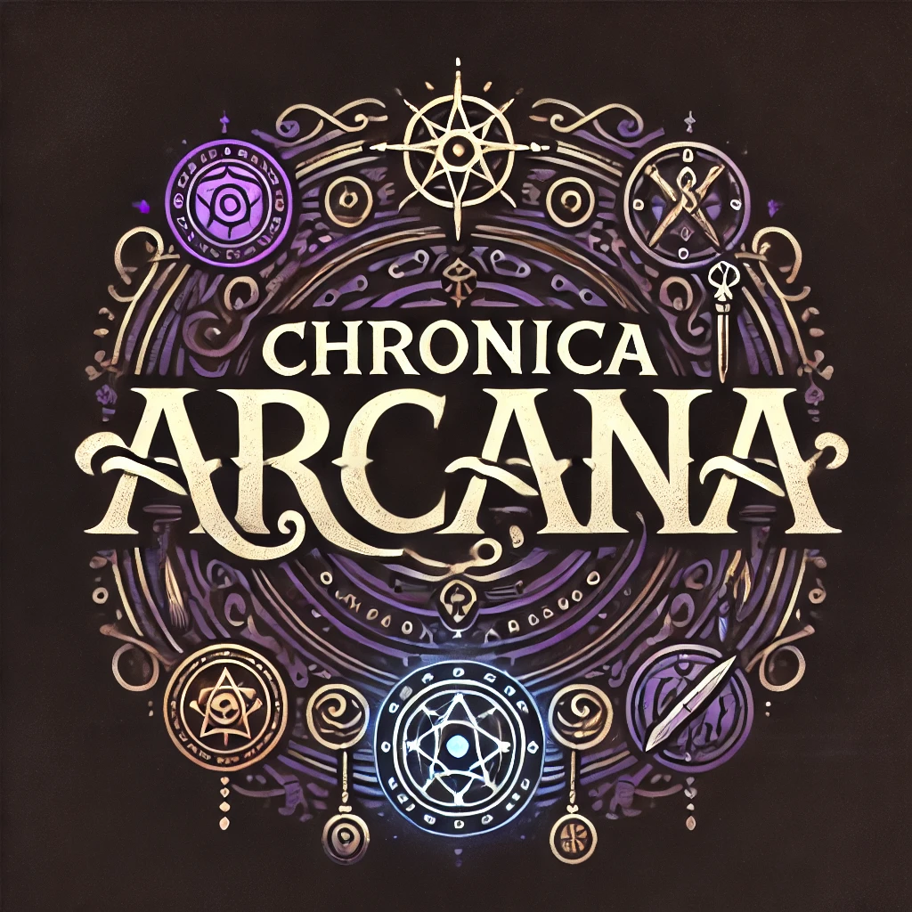

# Chronica Arcana: Archive of M.A.G.U.S. RPG Writings

<p align="center">
  
</p>

**Live site:** https://aporkolab.github.io/ancient-chronicles/

## About This Project

Chronica Arcana is a digital archive of my personal writings for the Hungarian role-playing game M.A.G.U.S. (Miracle Adeptia Guns Urrus Sorrate, First Codex). The material was originally written between 2001 and 2002 and rediscovered on an old CD in May 2023.

The archive brings these old creations back to life: monsters, character classes, player characters, an adventure module, a short story and poems. Some of the original texts survived only in fragments; these have been completed, and the whole collection has been edited for this edition. The site is designed to resemble a *diskmag* (disk magazine), a popular format of the early personal-computer era, and it has a built-in jukebox with fantasy-themed instrumentals and songs set to four of my poems.

The content is in Hungarian.

## Features

- **Content archive:** monsters (bestiary), character classes, player characters, an adventure module and a short story.
- **Diskmag UI:** a retro user interface inspired by old-school disk magazines.
- **Jukebox:** an in-app music player with playlist, shuffle, loop, equalizer and visualizer.
- **Responsive design:** works on desktop and mobile.

## Tech Stack

- [Angular 22](https://angular.dev/) (standalone components, lazy-loaded routes)
- [Bootstrap 5](https://getbootstrap.com/)
- [Font Awesome](https://fontawesome.com/) (brand icons)
- TypeScript, SCSS

## Getting Started

Prerequisites: [Node.js](https://nodejs.org/) 22.22.3+ or 24 LTS.

```bash
git clone https://github.com/aporkolab/ancient-chronicles.git
cd ancient-chronicles
npm ci
npx ng serve
```

Then open `http://localhost:4200/`. The app reloads automatically when you change a source file.

## Build

```bash
npm run build
```

The output goes to `dist/ancient-chronicles/browser/`. To preview the production build locally:

```bash
npm run start   # serves the build at http://localhost:3000
```

All asset references (images, CSS backgrounds, music) are relative to the base href, so the same build works at the domain root and under a sub-path such as `/ancient-chronicles/`.

## Tests

```bash
npx ng test --watch=false --browsers=ChromeHeadless
```

Unit tests run with Karma and Jasmine.

## Deployment

Every push to `main` runs the tests, builds the app with `--base-href /ancient-chronicles/` and publishes it to the `gh-pages` branch (GitHub Pages) via `.github/workflows/deploy.yml`. `scripts/spa-routes.mjs` writes a copy of `index.html` for every route, so deep links are served with HTTP 200 instead of falling back to `404.html`.

## License

This project is licensed under the **Creative Commons Attribution-NonCommercial-ShareAlike 4.0 International License** ([CC BY-NC-SA 4.0](https://creativecommons.org/licenses/by-nc-sa/4.0/)). You are free to share and adapt the material for non-commercial purposes, as long as you give appropriate credit and distribute your contributions under the same license.

## Contact

Dr. Porkoláb Ádám – [adam@porkolab.hu](mailto:adam@porkolab.hu) – [adamporkolab.com](https://adamporkolab.com)
